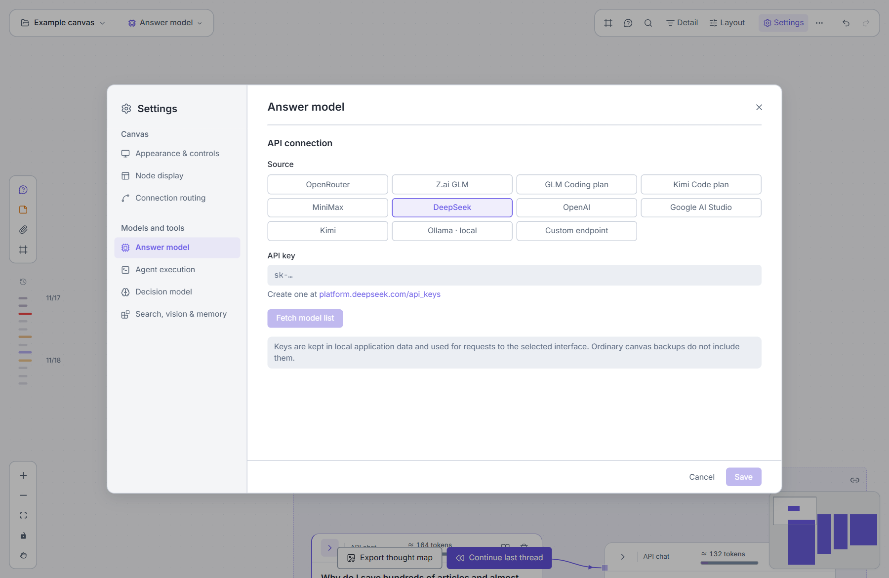
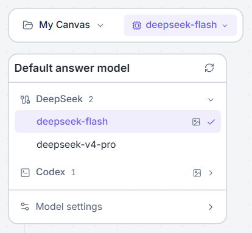

# Models, tools, and memory

## Connect and select a model

Open **Settings** in the upper-right toolbar. For a model endpoint, choose **Answer model → API connection**, authorize or enter a key, fetch the model list, and save the models you want to use. For a local agent, choose **Agent execution**. The default agent reasoning effort applies across canvases on this device. Supported models use the selected level on their next run. Codex uses the active canvas’s dedicated folder. You can view its path here and choose the approval mode for connected runs. See [Connect a model](/setup) for the available connection methods.

The upper-left toolbar shows the **default model for new nodes**. Open the model menu, expand a provider or agent and select a model to change the default. To use a different model for one node, select it in that node’s question composer. The shortcut in the model menu opens **Settings → Answer model**, where you can choose the default and manage API connections. Under **Models and tools**, **Decision model** manages auxiliary decisions. **Search, vision & memory** contains web search, image recognition and memory.

Each answer version records the model that produced it. Local models can run without sending model requests to a remote provider; remote costs and retention follow the endpoint you connect.

## Enable search and tools

Every ask box has **web search** and **scholarly search** switches. They determine which retrieval capabilities the generation may use; the model still decides whether to call them for the question. Search progress and supported references remain with the answer. Enable only the tools needed for the current task.

Developers who need additional tools can configure local or remote MCP servers in `mcp.config.json`. Supported transports include stdio and URL-based connections. Tool availability changes **what the model may call**; it does not change which graph paths enter the request. See [Connection mechanism for developers](/setup#connection-mechanism-for-developers).

## Manage ambient memory

Ambient memory admits selected long-lived facts in three categories: preferences, user-stated identity, and project information. Every write produces a visible notification with **Undo**. Project memories stop entering active context after 45 days without an update, but remain in the memory manager.

Use the global memory switch, category controls, import/export, or deletion when persistent background context is not appropriate. Machine steps and generated guides are not admitted as ambient memory.

Use the memory manager to inspect the entries admitted as ambient memory. Graph wires and ambient memory remain separate layers; conversation details do not display a context tree.

## Keep the layers distinct

- The **model** determines which endpoint generates the answer.
- **Tools** determine which external actions it may call.
- **Ambient memory** can add admitted background facts.
- Graph wires still determine the visible conversation and material paths entering the node.

See [Connect a model](/setup) for the in-app flow, plan routes, and local models. See [Privacy and storage](/reference/privacy-storage) for the data boundary.
