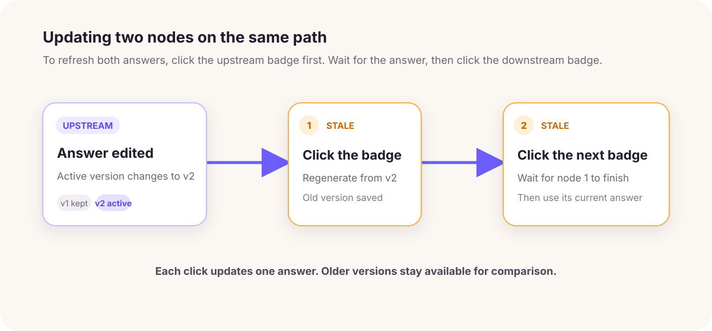

# Versions, staleness, and replay

## Compare answer versions

**Regenerate in place** adds another answer version to the same node. Switch between versions, remove an unwanted version, or restore an earlier one. Use a [sibling node](/guides/conversations#regenerate-and-compare) when the comparison should remain visible on the canvas.

## Understand stale answers

Generated nodes record a fingerprint of their upstream context. Editing an ancestor, changing a relevant wire, or switching the active upstream version can mark dependent nodes **Stale**.

**Stale** means “generated from an older input,” not “incorrect.” Inspect the context difference before deciding what to update.

## Update a stale node {#replay-dependent-work}

Review the changed source and the node’s [input connections](/guides/context-control#inspect-the-next-request). To update its answer, click **Upstream changed** on that node. The new answer is saved as another version.

If you want to update two nodes on the same path, start with the upstream node. Wait for its answer to finish, then click **Upstream changed** on the downstream node so it uses the new answer.

