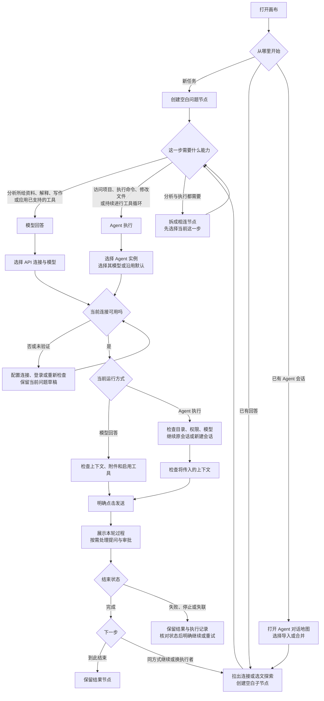
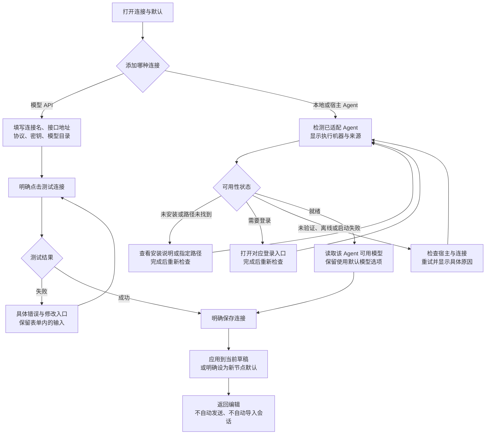
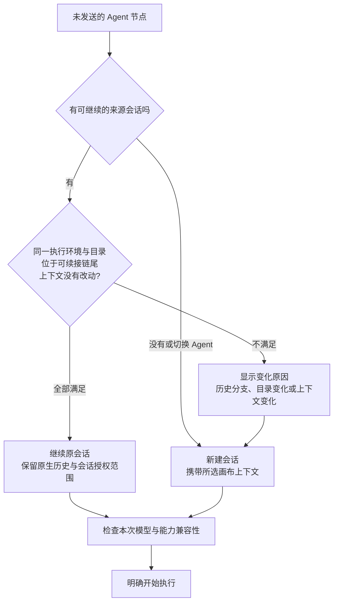
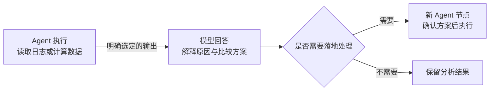
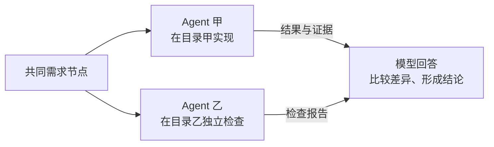
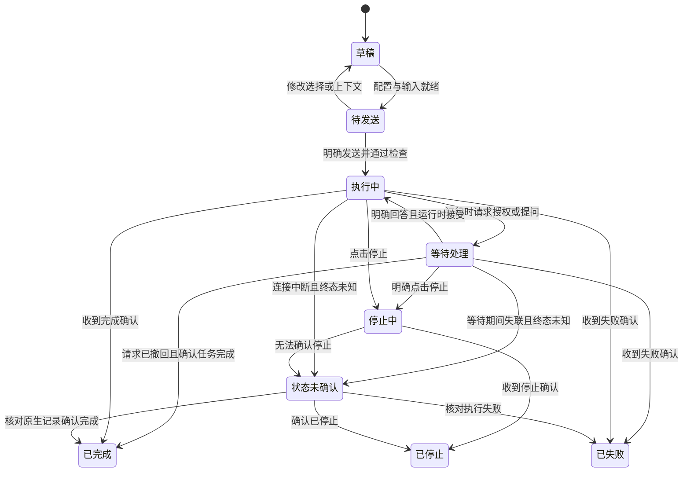

# 模型与 Agent：用户操作流程及 GUI 方案

状态：设计提案，尚未替换现有应用交互。核对日期：2026-11-05。

配套文件：[总流程图（SVG）](./model-agent-flow/model-agent-main-flow.svg) · [交互流程演示（HTML，可下载后离线打开）](./model-agent-flow/model-agent-flow.html)。

本方案回答四个问题：这一步由谁完成、怎样接入和选择、怎样把上一轮结果交给下一步、用户在哪里检查并明确开始执行。现有能力和待开发内容见第 10 节；图中的目标流程不能当作全部已经实现。

## 1. 用户需要理解的三个概念

| 概念 | 用户能做的事 | GUI 中的名称 |
| --- | --- | --- |
| 运行方式 | 决定由应用直接请求模型，还是由 Agent 在工作环境中执行任务 | `模型回答` / `Agent 执行` |
| 连接 | 找到可用的 API 接入，或可用的 Agent 实例及其所在机器 | `连接与默认` |
| 模型 | 在所选连接提供的范围内，选择这一步实际使用的模型 | `模型`，或 `使用 Agent 默认模型` |

**一个问题节点在一次执行中只使用一种运行方式。混用发生在节点之间。** 同一个底层模型，经 API 调用与放进 Agent 工具循环，拥有的工作环境、工具、会话和权限可能不同。

模型回答可以使用应用已经接好的搜索或其他工具，不等于只能写文字。本地 Agent 的“本地”指工具和工作目录所在的位置，不代表推理离线，也不代表数据不会发送给模型服务。选择取决于任务需要的能力，不以品牌、价格或“智能程度”猜测。

产品界面使用功能名称及用户自定义连接名，例如“研究接入”“项目助手”；不把第三方品牌写进引导、示例或推荐。技术文档、协议和导入格式身份保留准确名称。真实模型标识作为功能配置值展示，不用品牌作营销文案。

## 2. 总流程：先明确这一步要做什么



这张图描述决策关系，不要求每轮弹出向导。已经配置好的连接、目录与权限，通过新节点的紧凑摘要直接复用；仅在缺项、冲突或用户主动展开时出现完整设置。

### 何时用哪种方式

| 用户当前要做的事 | 默认建议 | 发送前必须确认 | 何时需要改变方式 |
| --- | --- | --- | --- |
| 阅读上传的资料、写总结、解释问题、比较方案 | 模型回答 | 模型能接收资料类型；实际传入材料 | 要继续处理本地项目或执行程序时，创建 Agent 子节点 |
| 根据网页搜索回答问题 | 模型回答，启用已接入的搜索 | 搜索工具可用；必要时展示来源 | 需要浏览器自动操作、下载整理或应用未提供的工具时，选择具备该能力的 Agent |
| 检查项目、运行测试、修改文件、生成本地成果 | Agent 执行 | Agent、工作目录、权限、工具及会话去向 | 完成后只需对选定结果作解释、独立复核或写报告时，可转模型回答 |
| 继续一个已有 Agent 的任务 | 优先继承原 Agent | 能否继续原生会话，目录是否一致 | 想独立研究、改变上下文、换 Agent 时，新建会话并明确传入内容 |
| 多个模型比较同一问题 | 多个模型回答分支 | 每个分支的模型和相同输入 | 通常不需要 Agent；每次实际发送仍需明确触发 |
| 多个 Agent 处理同一项目 | 多个 Agent 节点 | 独立任务边界、目录和并发写入安排 | 只读结果可汇总；存在同目录写入时应排队或隔离目录 |

不要自动将 API 失败降级为 Agent，或将 Agent 不可用替换成 API 回答。两者可能产生不同副作用和输出，应提示用户重新选择。

## 3. 首次接入：配置一次，后续复用

左上项目工具栏保留接入入口，建议统一命名为 **连接与默认**。工具卡片沿用 320px 宽度，复杂表单通过明确入口打开模态；不把整套接入设置塞进每个节点。



### 接入 GUI 的具体字段

| 位置 | 必须展示 | 必须可操作 | 保存与验证语义 |
| --- | --- | --- | --- |
| 连接列表 | 用户命名、类型、执行位置、可用状态 | 添加、编辑、检查、移除、设为默认 | 发现记录不等于已验证；移除不删除原 Agent 历史 |
| API 设置表单 | 名称、协议、地址、掩码密钥、模型列表或模型 ID | 测试连接、保存、取消 | 测试与保存分开；测试说明是否可能产生少量请求用量 |
| Agent 接入详情 | 实例、执行机器、已检测路径、状态、模型目录 | 重新检查、打开登录/安装入口；具备能力时指定路径 | 不要求把 Agent 的登录凭据再填进 API 表单 |
| 默认设置 | 新节点运行方式、连接、模型或沿用默认 | 应用默认设置 | 仅作为后续节点初始选择；不批量改已有节点 |

可用性至少分成：`未检测`、`检测中`、`未找到`、`需要登录`、`就绪`、`离线`、`不兼容`、`检测失败`。后端不能提供某一事实时显示“未验证”，不得仅凭查到可执行文件或模型目录就称为就绪。

自动检测只读位置与可用性；不会自动安装软件、登录账户、启动任务、读取所有历史进模型，或把不同会话连接起来。读取模型目录可能按运行时需要短暂启动本地进程，不能因此称为任务已开始。

## 4. 每次发送：选择发生在新问题节点

### 推荐 GUI 结构

```text
左上项目工具栏
┌──────────────────────────────────────────────────┐
│ 画布名称    连接与默认    Agent 对话地图           │
└──────────────────────────────────────────────────┘

新问题节点（模型回答）
┌──────────────────────────────────────────────────┐
│ 待发送 · 模型回答                                 │
│ 请输入这一步的问题……                             │
│ 上下文：2 个节点 · 1 份材料       [检查上下文]     │
│ [模型回答 ▾] [研究接入 / 模型甲 ▾]                │
│ 工具：搜索                                       │
│                                      [发送问题]  │
└──────────────────────────────────────────────────┘

新问题节点（Agent 执行）
┌──────────────────────────────────────────────────┐
│ 待发送 · Agent 执行                               │
│ 请根据上游方案检查项目并运行测试……               │
│ [Agent 执行 ▾] [项目助手 ▾] [使用默认模型 ▾]      │
│ 目录：D:/project                  [更改]          │
│ 权限：需要时询问                  [设置]          │
│ 会话：新建 · 带入所连上下文        [查看原因]      │
│ 上下文：2 个节点 · 1 份材料        [检查上下文]    │
│                                      [开始执行]  │
└──────────────────────────────────────────────────┘
```

发送按钮的行为由已选择的运行方式确定，文字随之改变。设置动作本身不发送。没有可用连接、问题为空、所需目录缺失或关键能力不支持时，按钮禁用并在相邻位置给出可处理的原因。

已完成节点与阅读详情只展示真实来源、结果及过程。继续提问通过拉出连接创建空白子节点；不在已完成阅读区重新加入模型选择和续问输入。

### 模型和 Agent 的选择顺序

| 选择 | 控件 | 内容与规则 |
| --- | --- | --- |
| 运行方式 | 两项选择器：模型回答 / Agent 执行 | 可改变当前未发送节点；不会立刻发请求 |
| API 连接 | 按用户命名的连接分组列表 | 仅列可用连接；缺失连接仍显示原因和修复入口 |
| API 模型 | 当前连接的模型列表 | 展示实际支持的输入类型/能力；不知道成本和上下文上限时不编造数值 |
| Agent | 实例列表 | 先选实例，再选其模型；同类型多个实例应能通过名称与执行位置区分 |
| Agent 模型 | 默认模型项 + 实例报告的模型列表 | 模型不跨 Agent 混列；能力不支持时不显示虚假选项 |
| 思考强度 | 当前模型支持的枚举控件 | 默认沿用运行时设置；不支持时隐藏，不凭名称猜测 |
| 工作目录 | 路径摘要 + 目录选择入口 | 显示宿主机器；原生选择器或明确路径表单取决于当前桥接能力 |
| 权限 | 权限摘要 + 配置卡片 | 默认沿用项目规则；扩权显式提交；不能继承其他 Agent 的会话授权 |
| 上下文 | 数量摘要 + 检查面板 | 节点、回答版本、材料片段、工具记录分别可检查 |

不要将“模型 API”和“Agent”平铺成一长串看似等价的模型名字。常用入口可以保持紧凑，但展开后必须看清两层关系。

### 默认继承与选择作用域

1. 当前节点明确选择优先，入口旁显示“本节点”。
2. 目标规则：从 Agent 来源节点创建子节点，默认继承其 Agent 与工作目录；入口旁显示“继承来源”，用户明确指定的目录优先。当前不同导入来源的继承支持并不一致，需要统一，不能把这条当作所有来源已经具备的能力。
3. 从普通来源创建子节点，保留已有的父节点显式模型继承；补齐父节点未固定模型时按实际生成来源继承，以及多父节点来源冲突时在当前节点明确选定的规则。
4. 无来源的新节点使用画布默认；没有画布默认才使用应用默认。画布级默认是本方案建议新增，当前主要是全局默认。
5. 默认设置变化不应静默改变正在输入的草稿；草稿采用创建时的初始选择，可明确点击“使用当前默认”。
6. 运行开始后保存实际连接、模型、目录、会话、权限与上下文快照。之后改变默认值只影响后续操作，历史来源保持原样。

## 5. 继续会话还是创建新会话

用户不必学习原生协议，但必须在发送前看见会话去向。Agent 模式始终显示该行；原因通过“查看原因”展开。



同一 Agent 内更换模型不必然新建会话；由实际运行时支持情况决定并显示结果。若不能精确分支，则新建会话并携带所选上下文，不假装原生历史已被改写。

**原生续接可能继续使用 Agent 自身保留的历史，不能只按画布可见节点数理解上下文。** 检查面板中区分“原生会话已有历史”和“本次新增输入”。用户要严格排除某段历史时，改为新会话，以检查过的画布上下文起步。

导入的外部会话可能仍在其他窗口执行。列表应标明运行状态；不知道时显示“状态未确认”。新发送前发现同一会话正在执行时，提示回到原窗口、等待完成或另建分支，不同时向同一会话悄悄追加两轮。

## 6. 何时混用，以及怎样交接

### 场景一：先整理要求，再操作项目，再解释结果


用户从 A 拉出子节点，在 B 选择 Agent、目录、权限并检查输入后执行。B 完成后，再拉出 C，选择模型回答，只带入需要复核的结果。复核节点不自动获得项目文件访问能力；缺少证据时显示缺项，或再接一个 Agent 补充取证。

### 场景二：先从本地取证，再分析，再决定是否执行



适合“计算/取证”和“解释/决策”交替。不要为了混用而增加没有独立作用的中间节点；同一 Agent 已能完成整个任务时，可以直接继续。

### 场景三：多个执行者提供结果，再汇总



不同 Agent 默认隔离执行会话和授权。共享目录中的文件是额外的信息渠道：即使画布没有连线，两个 Agent 仍可能读到同一文件变化。GUI 必须显示目录复用状态；“断开上下文边”不等于隔离磁盘。

### 交接面板到底显示什么

| 交接方向 | 默认可带入 | 必须重新选择或检查 | 不自动传递 |
| --- | --- | --- | --- |
| API → Agent | 已启用上游问题/回答、选定材料与任务约束 | Agent、模型、目录、权限、会话去向 | API 密钥、另一服务的登录、执行授权 |
| Agent → API | 回答、选定 diff/测试证据、显式选中的文件内容或片段 | API 模型、材料可用性、远程请求中的内容 | 工作目录权限、未选择文件、可继续执行的工具句柄 |
| Agent 甲 → Agent 乙 | 明确选定的任务、结果和材料 | 乙的模型、目录、权限、新会话 | 甲的原生会话身份、会话批准规则 |
| API 甲 → API 乙 | 当前所连的上下文与材料 | 乙的模型输入能力、长度限制 | 甲的凭据、隐藏状态 |

默认以必要的回答与证据交接，不盲目携带全部工具日志。工具记录被当作历史证据，不作为待执行命令。界面显示“将发送的内容”，允许展开文本预览、排除来源和查看截断；不可用的附件必须明确标出，不用空内容假装传入成功。

本方案不引入“自动执行下游”开关。创建边只建立上下文关系，每个下游节点仍明确发送。如果以后引入自动编排，需要独立设计可审阅的执行计划、停止范围、预算和授权边界。

## 7. GUI 清单：每个决策在哪里完成

| 编号 | GUI / 位置 | 对应决策 | 主要控件与动作 | 关闭与草稿规则 |
| --- | --- | --- | --- | --- |
| G01 | 左上 `连接与默认` 工具卡片 | 有哪些可用连接；新节点默认用谁 | 两类连接、可用状态、添加、管理默认 | 外点收起；配置草稿不提交 |
| G02 | API 连接设置模态 | API 接到哪里 | 名称、协议、地址、密钥、模型目录；测试、保存 | 非敏感草稿可恢复；密钥仅表单内存；Esc 不保存 |
| G03 | Agent 接入详情 | 选择哪个实例、是否能用 | 机器、路径、状态、模型；检查、登录/安装入口 | 不自动安装或登录；能力不支持时给原因 |
| G04 | 新问题节点底部运行条 | 这一步由模型还是 Agent 完成 | 运行方式、连接/实例、模型、强度 | 选择只改变草稿；输入及按钮是同一编辑边界 |
| G05 | Agent 目录与权限卡片 | 在哪里操作、允许什么 | 目录摘要、选择目录、权限模式、明确应用 | 外点保留草稿；扩权不因选择器关闭而提交 |
| G06 | 节点会话去向行 | 原会话续接还是新建 | 去向、原因、来源会话、执行状态；必要时改为新建 | 只读预览无进程、目录创建等副作用 |
| G07 | 上下文检查工作面板 | 下一步实际接收什么 | 来源、版本、材料、工具记录、原生历史提示、文本预览 | 非模态，允许同时改连线；修改保持草稿，明确应用 |
| G08 | 节点与阅读详情活动流 | 正在做什么、是否需要干预 | 进度、工具、输出、文件差异；停止、支持时补充指令 | 阅读外点不停止；关闭面板不等于取消任务 |
| G09 | 待处理请求卡片 | 是否授权、如何回答 | 操作、目标、范围；拒绝、仅本次允许、支持时本会话允许 | 关闭不授权，待处理状态持续可见；默认聚焦取消/拒绝 |
| G10 | Agent 对话地图 | 带入哪个现有会话 | 来源、目录、运行状态、导入、多选合并、监听 | 选择导入才建图；合并不自动跨会话连线 |
| G11 | 完成节点与端口 | 继续、换执行者或结束 | 真实执行来源、结果、证据；拉线、选文探索 | 拉线只建空白子节点；不立即生成 |
| G12 | 失败/失联恢复区域 | 继续还是重试 | 已完成活动、文件变化、宿主状态；核对、继续、新建重做 | 不自动重放；新执行保留原失败记录 |
| G13 | 目录冲突提示 | 多个 Agent 是否可同时写 | 当前占用任务、路径；排队或改用独立目录 | 仅检测到相关冲突时出现；不冒充已有隔离能力 |

### 表面分工

- 全局工具栏负责连接管理和默认值，节点只暴露本次必要选择；已完成阅读区不出现发送配置。
- 连接、目录、权限的小卡片复用现有单一工具卡片位置，避免同时叠放多个卡片。
- 上下文检查和运行详情属于非模态工作面板，可与画布协同；窄屏顺序切换，草稿保留。
- 普通操作使用 14px 控件字，正文 16px，元信息 12px；沿用共享 token 的 6px 控件圆角、12px 浮层、14px 节点。实际实现以 CSS token 为准。
- 主题切换不改变结构；状态同时使用文本，不只靠颜色。键盘可到达全部选择、配置和提交动作。
- 多行问题 Enter 换行，Ctrl/Cmd+Enter 明确发送；中文组合输入期间 Enter/Esc 不触发动作。Esc 仅关闭顶层；常驻节点问题按既有规则失焦并保留草稿。

## 8. 执行状态与异常分支



| 情况 | GUI 行为 | 用户下一步 |
| --- | --- | --- |
| 没有 API，也没有可用 Agent | 空状态同时给两个接入入口 | 选择需要的一类，不强制先填 API 密钥 |
| 找到 Agent，但不能确认登录 | 显示“登录状态未验证”，保留错误详情 | 检查连接；确需登录时打开对应入口 |
| 模型不可用或附件类型不支持 | 禁用发送并定位具体缺项 | 换可用模型、转换材料或明确排除材料 |
| 上下文过长 | 展示超限或无法判断；不静默截断 | 选择片段、另建摘要节点或调整模型 |
| 同会话或同目录有相关执行 | 显示冲突对象及原因 | 等待、排队或选择独立环境 |
| 审批拒绝 | 记录用户决策，等待运行时后续状态 | Agent 可调整方法；用户也可停止，不把拒绝一律标成失败 |
| 连接断开 | 停止“正在顺利运行”的假象，明确终态是否已确认 | 核对原生会话；不能承诺自动无损恢复 |
| 停止后已有文件改动 | 保留差异和停止前的输出 | 用户检查成果；停止不会回滚文件 |
| 失败后重试 | 明示会重新执行，保留第一次记录 | 继续剩余工作或新会话重做，避免重复副作用 |
| 切换画布或关闭阅读面板 | 保留运行标识和待处理提示 | 可返回查看；是否继续取决于宿主实际生命周期 |
| 关闭应用或电脑休眠 | 不承诺后台继续运行 | 返回后核对宿主与会话状态 |

## 9. 一条完整的操作示例

目标：根据需求修改一个本地项目，并给出可读的验收报告。

1. 打开“连接与默认”，保存“研究接入”，检查“项目助手”的模型和登录状态。发现会话不自动导入。
2. 新建问题节点，选“模型回答 → 研究接入 → 模型甲”，加入需求材料，点击“检查上下文”，再点“发送问题”。得到需求与验收清单。
3. 从结果节点拉出空白子节点，填写“按这些条件修改项目并运行测试”。选“Agent 执行 → 项目助手 → 使用默认模型”。
4. 指定项目目录和权限；看到“新建会话，带入所连上下文”。检查需求材料是否可供执行者读取，明确点“开始执行”。
5. 活动流展示命令、文件变更和测试结果。遇到请求时明确答复；不因关闭卡片而批准。需要补充要求时用“补充指令”，只在运行时支持时提供。
6. 完成后拉出第三个空白子节点，改选模型回答，问题为“根据差异与测试记录写验收报告”。在上下文检查中选择需要的证据，明确发送。
7. 若复核发现问题，从该结论再接 Agent 子节点。由于带入了新的复核上下文，显示新会话或运行时实际支持的分支方式，不误标为未改动的原会话续接。

## 10. 当前实现、缺口和实施次序

下表只陈述本次源码核对结果，没有在本机逐一登录或真实执行所有 Agent。

| 事项 | 当前情况 | 本方案要求 |
| --- | --- | --- |
| 模型/API 与 Agent 目录 | 已有统一选择器与 Agent 分组 | 明确分成“运行方式 → 连接/实例 → 模型” |
| API 接入 | 已有兼容接口表单、模型目录获取及配置保存，尚无统一的实际生成验证 | 区分目录可读取、认证可用与实际请求结果；整理测试/保存流程 |
| Agent 发现 | 已有固定运行时及模型查询 | 区分未安装、未登录、离线与协议失败；不能都归入未找到 |
| Agent 实例 | 当前主要按运行时类型识别 | 多实例、多宿主能力未完整具备，接入列表按未来扩展设计 |
| 工作目录与权限 | 已有控件；权限主要是画布配置 | 在发送前展示生效范围；本轮快照与后续配置变化分离 |
| 会话续接与分支 | 核心路由已有 | 将预览完整接入新问题节点，显示去向与原因 |
| 默认选择 | 主要是应用全局默认与节点覆盖 | 新增画布默认和草稿选择快照；完整实现来源继承优先级 |
| 不可用模型回退 | 当前固定 API 模型失效时可能回退全局选择，若全局为 Agent 会跨运行方式；仅有提示 | 阻止静默跨方式回退，保留原选择并要求用户明确重新选择 |
| 活动、审批、停止、补充 | 已有不同程度的实现，取决于运行时 | 按能力显示，统一状态与异常恢复提示 |
| 上下文 | 已有图编译、引用和材料机制 | 统一发送前检查、原生历史提示与跨运行方式交接 |
| 多会话导入 | 已有导入、合并和增量镜像 | 保留手动导入和不自动跨会话连线的语义 |
| 同目录并发 | 未发现统一的跨 Agent 写入锁 | 新增冲突检测、排队或独立环境路径；先检测后开放并发写 |
| 下游自动编排 | 尚无通用跨 Agent 调度 | 本方案不默认引入；节点逐次明确执行 |

运行环境差异必须在 GUI 中体现：

| 环境 | 已有会话发现 | Agent 执行与限制 |
| --- | --- | --- |
| 桌面壳 | Codex、Claude Code、Pi、DeepSeek Harness；可选择额外目录 | 固定本地运行时接入主要是 Codex、Claude Code、Pi；发现 Harness 日志不等于可执行 Harness |
| 本地网页 + server | 当前默认目录只有 Codex、Claude Code、Pi | 可通过本地 HTTP 桥执行已支持运行时；Harness 扫描与任意目录添加尚未补齐 |
| Harness 插件 | 宿主会话与支持的其他本地来源 | 宿主提供 Harness Agent 执行；能否使用其他 Agent 取决于宿主上的适配和安装 |
| 无本地桥的远端网页 | 无法直接读取用户电脑的本地会话 | 显示需要连接宿主，不伪装本地 Agent 已就绪 |

建议依次落实：

1. **先把选择说清楚**：双层选择、作用域、实际执行来源、会话去向，修正无模型时只引导 API 的误解。
2. **再把接入和交接补齐**：可用性状态、API 测试保存、上下文检查、Harness 环境差异、草稿快照。
3. **再完善多 Agent 执行**：并发目录冲突、状态恢复、多实例支持；自动调度作为独立后续设计。

## 11. 验收清单

- 不填 API 密钥也能选择已经就绪的本地 Agent；未找到与未验证状态明确不同。
- 每个未发送节点能读出“这次用谁、用哪个模型、带什么上下文”；Agent 还包括目录、权限和会话去向。
- 更改全局或画布默认不改正在执行的节点、历史结果与正在输入的草稿。
- 已回答节点及阅读区没有第二套续问输入；拉线与选文只创建草稿节点，不立即生成。
- API 搜索等受控工具和 Agent 工具循环不会被错误等同；本地执行不被宣传为离线推理。
- 同一 Agent 内换模型按能力判断；跨 Agent 不继承原生会话身份或批准规则。
- 画布删改上下文后不宣称已修改原生日志；原生续接明确提示历史范围。
- 混用时可查看实际材料与工具证据；未提供的文件不被当作已读。
- 同目录写入冲突可见；断开图边不被描述为文件隔离。
- 授权、发送、保存配置、重试和删除都显式触发；外点、Esc、切换面板不执行副作用。
- 空草稿可恢复；密钥不进入普通草稿缓存；中文组合输入不误发；嵌套 Esc 只退出顶层。
- 审批拒绝、失联、停止中与已停止有不同含义；重试保留旧记录且不假装回滚。
- 深浅主题、窄宽度和键盘操作可用；长模型名和目录能查看完整内容。

## 12. 源码依据

- [交互标准](interaction-contract.md)：新节点输入、明确发送、草稿与退出、已完成阅读区边界。
- [设计语言验收](design-acceptance.md)：工具卡片、阅读区、画布的验证范围。
- [模型选择器](../../src/components/ui/ModelPicker.tsx)：API / Agent 分组与节点覆盖。
- [API 接入表单](../../src/components/ui/ApiKeyModal.tsx)。
- [Agent 目录控件](../../src/components/ui/AgentCwdChip.tsx)、[权限控件](../../src/components/ui/AgentPermissionChip.tsx)。
- [Agent 运行与路由](../../src/lib/agents/agent-runtime.ts)：目录、继承、会话续接预览及实际运行。
- [当前运行时约定](../../runtime/agents/README.md)、[Codex 活动边界](codex-activity.md)。
- [API/Agent 请求分派](../../src/lib/api.ts)、[上下文编译](../../src/store/context-builder.ts)。
- [Agent 对话地图](../../src/components/SessionAtlas.tsx)、[多会话合并](../../src/lib/atlas/canonical.ts)。
- [本地网页扫描来源](../../runtime/sessions-fs.cjs)、[HTTP 会话桥](../../src/lib/atlas/dsh-bridge.ts)。

配套交互示意只模拟选择和状态，不连接模型、不运行 Agent、不保存凭据，也不能用其演示状态证明真实后端已实现。
