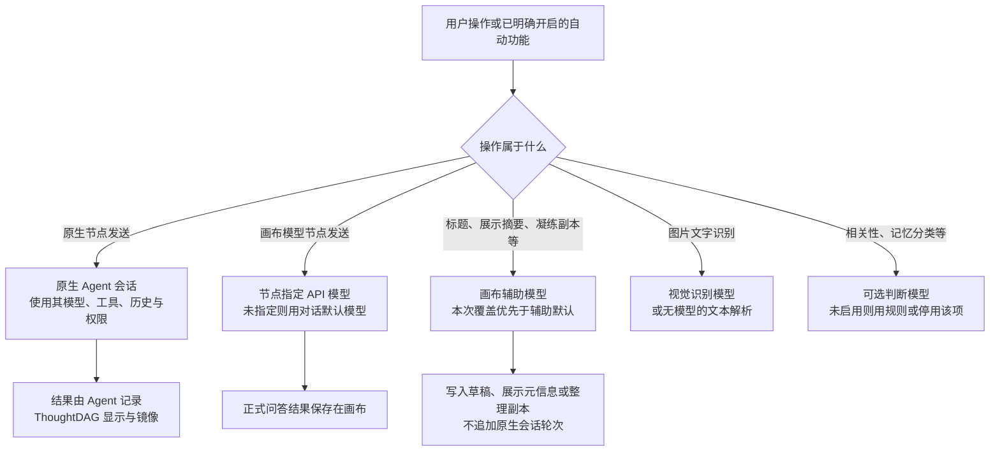
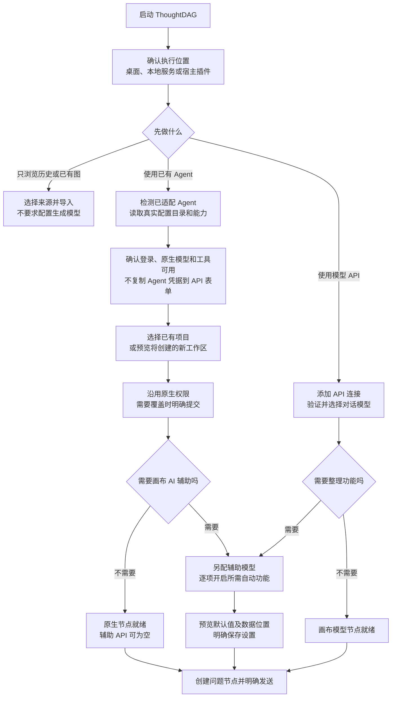

# 原生 Agent、全局默认模型与辅助功能：场景、GUI、初始化和文件归属

状态：产品设计提案及当前实现核对，2026-11-05。本文细化并修订 [上一版操作流程](model-agent-user-flow-proposal.md) 的执行归属；尚未实施应用改造。文中“建议/目标”是待实现规则，“当前”是源码事实；没有用演示或测试桩证明所有真实 Agent 已可用。

## 1. 先把四件事拆开

| 问题 | 对应概念 | 谁决定 |
| --- | --- | --- |
| 这一轮是谁在执行？ | 原生 Agent 节点，或画布模型节点 | 当前节点与其来源会话 |
| Agent 用什么模型、工具、历史？ | Agent 的原生配置和会话状态 | Agent 自己；用户可以在支持时显式覆盖本轮模型 |
| ThoughtDAG 的标题、摘要、凝练按钮调用谁？ | 画布辅助模型 | 独立辅助配置，不跟随原生节点的 Agent |
| 文件在哪台机器、哪个目录？ | 执行宿主、业务工作目录、各自状态目录 | 工作区与宿主绑定，不由模型名称决定 |

**“全局默认模型”不能继续承担这四种含义。** 它是一项选择的默认值，不是一个有工作目录、有历史、有搜索和命令工具的执行者。

建议把配置明确拆成：

1. **新节点默认方式**：原生 Agent / 画布模型。若选 Agent，再选默认 Agent 连接。只影响尚未创建的节点。
2. **对话默认模型**：给画布模型节点使用的 API 模型；不覆盖原生 Agent。
3. **画布辅助模型**：标题、展示摘要、凝练副本、复盘等文字任务所用的 API 模型。可显式与对话默认模型相同，也可不同。
4. **高级辅助配置**：视觉识别模型、判断模型，按需启用；凝练可在本次任务中覆盖文字辅助模型。

这些是用途槽位，不要求用户购买或配置四套服务。同一个兼容 API 连接可以承担多个支持的用途；只使用原生 Agent 时，所有 ThoughtDAG API 槽位都允许留空。



节点标记推荐使用 `原生 Agent` / `画布模型`，用户自定义连接名，例如“项目助手”“研究接入”。文档里的 Codex、DeepSeek Harness、Claude Code、Pi 用于说明真实适配器、协议与目录；产品引导、推荐和示例保持通用名称。

## 2. 什么叫原生 Agent 节点

### 2.1 目标定义

一个原生节点对应一个真实 Agent 会话中的一轮工作。它持有执行宿主、Agent 实例、原生会话 ID、轮次 ID、工作目录和真实模型记录。用户在节点里说“搜索资料”“查看这个文件”“运行测试”“把改动写进去”，由该 Agent 自己选择和调用它原有的工具。

ThoughtDAG 在此模式提供输入、事件传输、审批转发、停止/补充指令入口、结果展示与画布镜像。**不再用 ThoughtDAG 的搜索、CLI 或文件编辑实现替代 Agent 的同名能力。** 也不为一轮原生对话悄悄追加 API 摘要、记忆查询或另一个 Agent 的工作。

“原生”不等于无权限约束，也不等于完整复刻其官方桌面应用。只能展示当前运行时公开接口确实开放、且适配器已经实现的能力；原生工具循环可以完整交给 Agent，但特定交互插件/登录页/远端功能可能仍需回到其原应用。GUI 要列出能力和不支持项，不能只标“100% 支持”。

### 2.2 能力归属

| 能力 | 原生 Agent 节点 | 画布模型节点 | ThoughtDAG 辅助动作 |
| --- | --- | --- | --- |
| 模型与推理参数 | 沿用原生会话或 Agent 默认；支持时本轮覆盖 | 节点固定值或对话默认 API | 本次覆盖或对应辅助默认 API |
| 主历史 | Agent 原生会话 | 图路径编译出的消息 | 当前操作选择的只读输入 |
| 搜索、读写文件、CLI、MCP、子 Agent | 使用 Agent 自己的工具与配置 | 仅应用明确提供并启用的工具；不能假装拥有目录访问 | 文字整理默认不授予执行工具 |
| 角色、项目指令、技能 | 原生 Agent 原有配置 | ThoughtDAG 的角色与图上下文 | 此辅助任务的固定提示 |
| 权限与沙箱 | 默认沿用原生策略并转发审批；覆盖必须明确 | 应用工具的权限 | 不继承主 Agent 的批准规则 |
| compact | Agent 自己的会话压缩 | 不存在该 Agent 的 compact | 不是画布凝练按钮的含义 |
| 输出业务文件 | Agent 在明确 cwd / 目标路径写入 | 通常先得到内容；显式下载/保存是另一步 | 写草稿、元信息、派生副本，非项目文件 |
| 费用与记录 | Agent 所用的账户、服务和日志 | API 连接所用账户与画布记录 | 独立辅助请求及其实际模型记录 |

即使两处模型名称相同，登录方式、工具、历史和调用账户仍可能不同，不能视为同一条执行通道。

### 2.3 纯原生配置下，ThoughtDAG 应默认关闭什么

| 项目 | 目标规则 |
| --- | --- |
| 自动标题、展示摘要、缩放摘要 | 不发额外模型请求；优先用源会话标题、问题首行和确定性截取 |
| ThoughtDAG 记忆/画像与跨会话回忆 | 不自动查询、不注入、不在结束后自动提取 |
| ThoughtDAG 角色与编译历史 | 不隐式插入；原生项目指令和用户已有技能保持原样 |
| ThoughtDAG 搜索与 MCP 开关 | 原生节点隐藏；显示“由当前 Agent 的工具配置控制” |
| 材料预处理 | 不自动调用 API OCR/摘要，也不偷偷复制到业务目录 |
| ThoughtDAG 自加工具/提示 | 不默认注册或激活，如历史查询工具和“修改前查询历史”提示 |
| 自动重跑、持续评审 | 纯原生入口默认关闭；用户明确创建并授权的自动流程另行标识 |
| guard 或权限策略覆盖 | 新增“沿用原生配置”；不因为选择原生模式就变成全放行 |

如果用户原本就在 Agent 配置里安装了 ThoughtDAG 工具/技能，纯原生连接不会擅自删改该配置。需要“运行时也完全不包含这类能力”时，应使用用户确认的独立配置档；运行时不支持隔离配置时，要说明限制。

### 2.4 原生会话与可编辑画布的边界

原生历史由 Agent 维护，画布不能通过改文字、删除节点或断边偷偷改写它。建议原生轮次的问答保留真实记录；名称、摘要和位置可以整理，但必须标明只是展示信息。修改问答内容时生成整理副本，并保留原始来源。

沿原生链尾继续时，只提交这一轮问题和用户显式附加的输入。若用户想把其他节点、改写后的内容或凝练结果带进去，需要明确选择 **“以所选上下文新建会话”**。新会话仍由同一个 Agent 执行原生工具，但它的起点是用户批准的画布快照，不是原会话无缝续聊。

连线因此必须显示其作用：原生链内表示真实会话顺序；跨来源输入需要明确形成交接。编辑原生链的上下文关系后，界面提示将新建会话，而非让用户误以为旧历史已被移除。该语义需要产品与数据层一起实现，不能只换连线样式。

## 3. 什么叫全局默认；具体优先级

| 用途 | 目标优先级 | 禁止的回退 |
| --- | --- | --- |
| 原生会话继续 | 用户显式本轮覆盖 → 会话当前模型 → Agent 原生默认 | 不回退到 ThoughtDAG API；不因全局选择变化换 Agent |
| 原生新会话 | 本节点所选 Agent/模型 → 该 Agent 默认 | 不从 API 默认模型推断原生模型 ID |
| 画布模型问答 | 节点固定 API → 已明确继承的来源 → 画布 API 默认 → 应用 API 默认 | 不可用时不跨到 Agent；保留问题并要求重选 |
| 画布聊天 | 本次明确覆盖 → 对话默认 API | 不因全局新节点默认是 Agent 而调用 Agent，也不暗用整理模型 |
| 标题、展示摘要、复盘 | 本次显式覆盖 → 文字辅助默认 API | 不借用正在执行的主 Agent；不扫描所有服务商逐个试 |
| 凝练副本 | 对话框指定 API → 凝练专设 API（可选）→ 文字辅助默认 API | 不作为原生 compact；不自动启动 Agent 工具循环 |
| 图片识别 | 任务覆盖 → 可用的视觉辅助 API | 不因为主模型名称相似就选它；普通文本解析无需模型 |
| 判断/标注 | 独立判断配置或明确选中的兼容 API | 不自动占用主 Agent 会话；不兼容端点不能假装可替代 |

表中顺序是“没有设置时如何继承”，不是“模型不可用时自动换谁”。已明确绑定的模型不可用时保留选择并报错。原生续接若无法读出会话模型，优先让运行时自行保持原设置；不能由 ThoughtDAG 猜一个模型或推理强度发送。记忆措辞、画像改写和专题档案生成归入文字辅助模型，相关性/分类归入判断模型，不增加隐藏的第五套默认值。

可以提供“与对话默认模型相同”的显式绑定，但 GUI 要显示当前解析后的模型和绑定状态。不同提供方之间的备用模型切换应为用户预先配置的允许列表；默认失败就报告，不把资料悄悄送到另一个连接。

每次调用记录 `用途、触发来源、实际连接、实际模型、输入范围、结果位置`。节点的“主执行模型”和“展示摘要生成模型”分开显示，不能因为摘要由 API 生成就改写节点的 Agent 来源。

## 4. 按物理操作区分：GUI 到底触发了什么

下表是目标产品规则。每行都应有固定归属，不能根据一句文案里是否含“摘要”来临时猜测。

| 编号 | 物理入口 / 触发 | 调用谁 | 输入、产物与主会话关系 | GUI 要显示什么 |
| --- | --- | --- | --- | --- |
| P01 | 原生节点输入框点发送 | 当前原生 Agent | 新增真实轮次，可发生文件/命令等副作用 | Agent、原生模型、cwd、会话去向、权限来源 |
| P02 | 画布模型节点点发送 | 本节点 API | 图路径与材料 → 正式回答 | API 连接、模型、启用的应用工具 |
| P03 | 节点名称/摘要编辑器点“AI 填写” | 文字辅助模型 | 本节点问答 → 标题/摘要草稿；不追加原生轮次 | “画布辅助 · 模型…”；生成后仍需保存 |
| P04 | 回答完成后自动生成展示摘要/缩放层次 | 用户已开启的文字辅助模型 | 只更新展示层；原问答不变 | 自动功能开关、实际模型、最近结果；纯原生默认关 |
| P05 | 右键或多选“更新展示摘要” | 文字辅助模型 | 所选节点 → 展示摘要 | 范围、辅助模型、开始按钮，不伪装原生执行 |
| P06 | “生成凝练副本” | 凝练任务选择的 API | 多个节点 → 独立精简画布副本；不改原生历史 | 所选链段、模型、输出位置、生成/取消、对照与应用 |
| P07 | “压缩原生会话” | Agent 自己的 compact 能力 | 改变该原生会话的有效历史；不产生画布凝练副本 | 能力支持、目标会话、影响、执行与进度；不支持则明确入口到原应用 |
| P08 | 在原生对话里输入“总结一下” | 当前原生 Agent | 正常新增总结轮次，之后仍在原生历史里 | 普通发送，不调用独立辅助模型 |
| P09 | 在原生对话里输入“把总结保存成文件” | 当前原生 Agent | 正式任务，可写业务文件 | 目标路径、工具活动和文件结果 |
| P10 | 上传 PDF 后解析可提取文本 | 本地解析器/宿主解析服务 | PDF → 可读文字；不需要 LLM | 提取状态、来源文件、是否保存副本 |
| P11 | 图片“识别文字”、扫描 PDF 的逐页识别 | 视觉辅助 API，或用户选择交给 Agent 的正式任务 | 两条路径分开；前者产生材料文字，后者新增原生任务 | “辅助识别”与“交给 Agent 处理”两个明确动作 |
| P12 | 材料导入后自动生成介绍 | 用户启用的文字辅助 API | 材料文本 → 展示摘要 | 自动开关与模型；纯原生不默认执行 |
| P13 | 材料阅读器“生成导读/分析” | 创建正式结果节点后选择执行者 | 是用户研究任务，可用 API 或 Agent；不是材料标签 | 新结果节点草稿、执行方式和发送 |
| P14 | “画布聊天/讨论这张图” | 本次覆盖或对话默认 API | 讨论画布，不自动获得原生工作目录权限 | 固定显示 API 模型；需要落地时“交给 Agent”生成草稿 |
| P15 | 复盘、时间线思路、分享标题 | 文字辅助 API | 已选画布证据 → 便笺、思路或分享草稿 | 范围和模型；分享仍需明确发布/导出 |
| P16 | 记忆提取、画像整理、专题档案 | 文字生成用文字辅助 API，分类用判断模型 | 派生资料；可能影响以后画布请求 | 读写来源、模型、独立功能开关；纯原生默认不参与 |
| P17 | 搜索历史、定位文件来源 | 本地索引/规则；语义扩展再按需调用辅助模型 | 只查索引；引用到节点须明确操作 | “本地检索”与“使用模型扩展”分开 |
| P18 | 多模型对比、选区综合、高光串联 | 正式结果节点的执行者 | 每项是实际生成任务，可能调用 Agent | 各分支执行者、数量、输入与明确批量开始 |
| P19 | 用户启用的持续评审/自动重跑 | 预先绑定的执行者 | 上游变化触发新执行；不等于普通连线 | 明确开关、触发条件、轮数/预算、暂停、影响目录 |
| P20 | 排版、改名、连线、折叠、局部搜索 | 本地确定性逻辑 | 改显示/图结构；无需模型 | 不出现虚假的“正在调用 AI” |
| P21 | 导出/下载已有结果、在编辑器打开文件 | 明确的本地/宿主文件动作 | 不是 LLM 生成；可能读写用户选定位置 | 路径、格式、覆盖确认；不使用主 Agent 额度 |
| P22 | 停止、授权、补充指令 | 所属运行时的控制接口 | 针对同一原生任务；不更换模型执行者 | 当前任务身份、动作范围与确认结果 |

### 三种“摘要”必须有不同名称

| 名称 | 目的 | 谁来做 | 对原生会话的影响 |
| --- | --- | --- | --- |
| 展示摘要 | 让画布容易浏览 | 文字辅助 API，或本地截取 | 无 |
| 生成凝练副本 | 整理选中内容，供人阅读或用于新的输入 | 凝练 API | 无；用户明确带回 Agent 才成为新输入 |
| 压缩原生会话 | 调整 Agent 自己继续运行时保留的历史 | 原生 compact | 有，由运行时管理 |

在对话里要求 Agent 总结是第四种表达方式：它属于正常主任务，不是 GUI 展示整理。不能把自然语言“总结一下”自动翻译成 compact。

## 5. 按用户需求区分：对话中想做什么

| 编号 | 用户意图 | 推荐路径 | 下一步 GUI / 明确行为 | 文件或会话落点 |
| --- | --- | --- | --- | --- |
| U01 | 只看以前的 Agent 对话 | 只读导入/镜像 | 选择来源和会话；不必配置 API 或登录生成 | 原始历史留在 Agent；镜像入画布 |
| U02 | 在画布里像原应用一样持续工作 | 原生 Agent 节点 | 选 Agent、原会话/新会话、工作目录，发送 | 原生历史 + 原业务项目 |
| U03 | 讨论方案，不操作项目 | 可直接继续原 Agent；也可明确新建 API 分支 | 不因任务“只是讨论”强迫切 API | 取决于用户选择的会话 |
| U04 | 正在聊，突然要读项目文件 | 若当前原生，直接说路径；若 API，则交给 Agent | API 中产生 Agent 子节点草稿，明确目录与输入后发送 | Agent 读取业务文件，回传结果 |
| U05 | 正在聊，要求真正修改文件 | 原生直接执行；API 转 Agent | 明确目标目录、期望改动和验收条件 | 改动写实际项目；对话文本不是已保存文件 |
| U06 | 仅想看一段示例代码，不落地 | API 或原生均可 | 普通问答，不创建工作区也可完成 | 问答结果 |
| U07 | 上传文件，只提取内容来问问题 | 画布材料解析 + API，或把原文件交给原生 Agent | 明确“作为材料”或“交给 Agent 读取” | 前者进入材料库；后者由 Agent 读取原路径/显式副本 |
| U08 | 搜索网上资料并继续分析 | 当前原生就用它的搜索；API 用应用已接入搜索 | 工具能力和所属方清楚，不同时跑两套搜索 | 所属主任务记录 |
| U09 | 长对话快到窗口上限 | 原生自动 compact 或其原生压缩入口 | 仅支持时提供控制，不用凝练副本冒充 | 原生有效历史 |
| U10 | 把长图整理短一些，便于阅读/分享 | 生成凝练副本 | 选内容、辅助模型，生成后对照 | 新画布/派生节点，原始记录保留 |
| U11 | 将凝练后的内容作为 Agent 新起点 | 先凝练，再明确交接 | 查看输入包，选“新建原生会话” | 新会话，不宣称替换旧 Agent 记忆 |
| U12 | 只想让原生 Agent 给出总结 | 正常向 Agent 提问 | 形成一轮真实回答 | 原生历史 |
| U13 | 希望所有功能只用已登录的 Agent，不配 API | 纯原生配置 | 辅助 AI 默认停用；可手动标题/本地预览；主 Agent 中明确要求总结 | 原生历史和业务文件；不创建隐藏辅助会话 |
| U14 | 想用 API 做辅助，但主工作继续原生 | 原生 + 画布辅助 | 单独配置辅助用途，显式开启自动项 | 辅助结果只进画布，主 Agent 仍原生 |
| U15 | 想让另一个模型复核实现 | Agent 完成 → API 复核节点 | 选择 diff、测试记录和必要文件内容 | API 分支；缺证据不推断为已验证 |
| U16 | 两个 Agent 接力 | 明确交接包 → 接收方新会话 | Agent、目录、权限重新确认 | 各有原生日志，可共享业务目录 |
| U17 | 多个 Agent 同时干活 | 分离任务与写入范围 | 写入冲突检测、排队或独立工作区 | 各自目录/分支；不能仅靠不连线隔离 |
| U18 | 在同一 Agent 内换模型继续 | 原生支持的本轮/会话模型切换 | 显示实际模型、是否仍可续接 | 同会话或新会话，以能力判断 |
| U19 | 修改原生旧回答或删掉某段不想再用 | 整理副本 + 新会话，或原生支持的明确历史操作 | 预览影响，不以画布隐藏等同删除原生历史 | 源记录和新输入分开 |
| U20 | 断网、失败或停止后接着做 | 核对原生状态再继续 | 显示已执行的动作和文件变化，不自动整轮重放 | 保留失败/中断记录 |
| U21 | 只需要导出已有内容 | 本地导出 | 选择格式和目录 | 下载/指定备份目录；无需模型 |
| U22 | 换电脑继续 | 分别迁移业务项目、画布、可迁移原生历史 | 重新绑定本机目录和登录；显示缺失来源 | 不能仅复制 Git 仓库或索引 |

**混用不是必需条件。** 原生 Agent 能完成阅读、讨论、搜索、修改和汇报时，可以一直留在该 Agent。混用只在用户需要独立复核、统一画布整理、另一模型输入能力、不同执行环境或显式比较时发生。

## 6. 只有 Agent、没有 API 时应是什么体验

主对话、原生工具、文件操作、原生历史、原生支持的 compact、已有会话镜像应照常可用，不用配置 ThoughtDAG API 来解锁。

| 功能 | 没有辅助 API 的目标行为 |
| --- | --- |
| 节点名称 | 源会话名称/问题首行；可手工改名 |
| 展示摘要 | 显示原文截取，注明预览；不伪称 AI 总结 |
| AI 填写标题/摘要 | 入口提示需配置辅助模型；可关闭功能，不循环报错 |
| 凝练副本 | 不可用并解释原因；可改为显式向 Agent 提出整理任务 |
| 原生 compact | 只取决于原生能力，不依赖辅助 API |
| PDF 可提取文本 | 仍可本地解析；扫描件可交给具有对应能力的 Agent |
| 记忆判断/专题生成 | 未配置则关闭或使用明确的本地规则；不静默另选服务 |
| 图排版、连线、名称、导入、导出 | 不受影响 |

不默认提供“拿主 Agent 偷跑一轮标题生成”的回退。如以后需要复用 Agent 账户做辅助，必须设计独立、明确可见的辅助任务通道，不占用主会话，不能保证所有 Agent 都能无工具/无持久化运行，因此不列为第一阶段能力。用户在原生主对话里主动要求总结始终可用。

## 7. GUI 结构与初始化顺序

### 7.1 设置面板

```text
模型与执行
  新节点默认方式       [原生 Agent / 画布模型]
  默认 Agent           [项目助手]
  对话默认模型         [研究接入 · 模型甲 / 未配置]

原生 Agent 连接
  实例与执行机器        [本机 · 项目助手]
  原生配置目录          [解析后的绝对位置] [打开]
  登录与运行能力        [就绪 / 未验证 / 需登录 / 异常]
  模型与思考设置        [沿用原生 / 本轮覆盖]
  权限来源              [沿用原生配置 / 明确覆盖]
  功能                  [搜索 / 文件 / CLI / compact / 补充指令…]

画布辅助（可全部关闭）
  文字整理模型          [接入 · 模型 / 未配置]
  凝练模型              [使用文字整理模型 / 单独指定]
  视觉识别模型          [接入 · 视觉模型 / 未配置]
  判断模型              [关闭 / 专用连接 / 支持的 API]
  自动展示摘要          [关]
  自动材料摘要          [关]
  记忆与专题辅助        [关]
  备用模型              [关闭 / 已明确配置的允许列表]

数据与工作区
  执行机器              [本机 / 已接宿主]
  业务项目目录          [D:/project] [选择]
  ThoughtDAG 数据目录   [解析后的实际位置] [打开]
  画布与材料位置        [实际位置与存储类型]
  完整备份目录          [未配置 / 已选择目录]
```

高级项按需展开；首次纯原生用户只需要完成 Agent 和业务目录两组，不必逐项配置辅助模型。

### 7.2 首次使用流程



目录探测、模型列表和会话去向预览不应创建业务文件、运行生成、修改权限或写入主会话。应用自身的基础设置存储可以初始化；只有明确“创建工作区”或第一次确认执行，才创建工作区及其必要材料文件。打开一个目录选择控件不应生成 README 或 guard。

API-only 且只讨论文本时，不要求用户先选择业务工作目录。需要保存本地成果或交给 Agent 时再补这一步。纯远端网页不得把浏览器路径当成宿主路径；不能访问本地执行环境时，明确显示“需要连接执行宿主”。

### 7.3 日常入口应如何显示

| 表面 | 最少显示 | 不应出现 |
| --- | --- | --- |
| 原生新问题节点 | Agent、原生模型/沿用默认、会话、cwd、权限来源、发送 | ThoughtDAG 搜索开关和全局 API 默认的伪覆盖 |
| 原生已完成节点 | 原生执行来源、工具活动、文件变化、会话定位 | 在阅读正文里混入辅助配置或第二套续问输入 |
| 画布模型节点 | API 连接/模型、图上下文、应用工具、发送 | 未确认的“已读项目”“已写文件”状态 |
| 标题/摘要按钮旁 | `画布辅助 · 当前实际模型`，结果为草稿 | 使用原生节点模型图标暗示来自 Agent |
| 凝练窗口 | `生成整理副本`、API 模型、所选范围、输出位置 | “压缩 Agent 记忆”之类错误描述 |
| 原生会话菜单 | 原生支持的继续、停止、压缩、返回原应用等 | 对不支持能力显示可点击但无效的按钮 |
| 运行状态/调用记录 | 主任务和辅助任务分区；分别显示实际执行者 | 一条混合进度掩盖额外模型调用 |
| 数据位置面板 | 三层路径、执行机器、实际备份覆盖范围 | 把 Agent home、项目目录、索引统称“文件夹” |

沿用项目交互标准：长内容外点保留草稿；Esc 只取消顶层；发送、配置保存、授权、创建目录和导出覆盖须明确触发；敏感输入不进入通用草稿缓存。已回答节点的后续提问仍通过拉线创建空白子节点。

## 8. 文件存放：三层所有权，另列备份

### 8.1 Agent 的状态目录不是项目目录

```text
执行宿主的用户目录
  .codex/                   ← Codex 配置、状态与原生会话
  .claude/                  ← 对应 Agent 的配置与原生会话
  .pi/agent/                ← 对应 Agent 的配置与原生会话
  .dsh/                     ← Harness 状态（可由 DSH_HOME 改址）

D:/project/                 ← 实际业务项目，Agent 在此读写和运行命令
  src/
  docs/
  output/                   ← 用户明确指定的业务成果（示例）

ThoughtDAG 数据目录          ← 画布、引用、辅助产物、索引、应用配置
完整备份目录                ← 用户另行选择，不能以索引替代
```

四种 Agent 可以分别维护各自历史，同时操作同一项目。无需把业务文件塞进 `.codex`，也无需为了换一个 Agent 复制整份业务目录。并发修改时另行选择隔离工作区/分支或排队；同一目录意味着能看见彼此文件变化。

Codex 的状态根目录默认是 `~/.codex`，可由 `CODEX_HOME` 指定；这是配置/认证/会话等状态的根，不是强制业务 cwd。[OpenAI 环境变量文档](https://learn.chatgpt.com/docs/config-file/environment-variables) 其他运行时按自己的配置和返回路径解析，ThoughtDAG 不把 Codex 的布局套到它们身上。

### 8.2 当前实际存储与目标设计

`~` 始终指执行宿主用户的 home；远程或插件宿主时不一定是浏览器所在电脑。以下 Agent 路径是本仓当前适配的默认值，不承诺每个版本/自定义配置都一致。

| 类别 | 当前存放 | 目标归属与操作 |
| --- | --- | --- |
| Codex 会话 | `~/.codex/sessions/**.jsonl`；当前部分扫描固定默认目录 | Agent 管；优先使用原生返回路径/真实 home，支持 CODEX_HOME |
| Claude Code 会话 | `~/.claude/projects/<cwd编码>/<session>.jsonl` | Agent 管；独立识别，不要求迁入 ThoughtDAG |
| Pi 会话 | `~/.pi/agent/sessions/<cwd编码>/*.jsonl` | Agent 管 |
| Harness 会话 | `${DSH_HOME 或 ~/.dsh}/sessions/<cwd编码>/<session>/session*.jsonl.zstd` | 宿主管；读取已适配版本 |
| Agent 登录和配置 | 各 Agent 原有机制 | 原生登录仍由原生系统管理，不拷贝进画布或 API 设置 |
| 业务项目文件 | 用户指定 cwd；原生工具可能写显式其他目标 | 用户/Agent 管，GUI 显示实际目录与授权范围 |
| 默认空白工作区 | 桌面：`<Electron userData>/workspaces/<canvasId>`；HTTP/插件：`~/.thoughtdag/workspaces/<canvasId>` | 统一可配置根并显示实际路径；不在“看一眼设置”时创建 |
| 自动落盘材料 | 当前 `<cwd>/.thoughtdag/materials/` | 纯原生不自动写；显式交接才准备输入副本，按任务隔离并提示 |
| guard | 当前 `<cwd>/.thoughtdag/guard.json` | 纯原生沿用原设置时不写覆盖文件；显式附加策略另存、说明生效范围 |
| 画布主数据 | IndexedDB，按 origin/应用 profile 隔离 | 保留应用数据语义；需要明确可备份的完整持久化形式 |
| PDF 等附件原件 | IndexedDB `att-content:<id>` 等 | 必须被完整备份覆盖；主数据之外的附件不能遗漏 |
| 画布索引源记录 | `${THOUGHTDAG_HOME 或 ~/.thoughtdag}/canvases/*.thoughtdag.json`，目前桌面写入 | 这是精简可检索记录，不是完整画布备份 |
| 历史索引、主题档案 | `${THOUGHTDAG_HOME 或 ~/.thoughtdag}/` 下 JSON/JSONL 等 | 应用管；索引可重建，人工编辑的档案不能一律当缓存删掉 |
| API 设置和密钥 | 当前可在 localStorage，服务端也读取环境变量/.env | 不宣称现有加密存储；目标将凭据与普通配置分离 |
| 导出 | 浏览器下载位置或明确备份目录 | 宿主返回路径时展示；浏览器只显示文件名与已发起下载，不能猜测最终绝对路径 |

### 8.3 建议统一的数据目录（待实现，不是当前目录树）

```text
<THOUGHTDAG_DATA>/
  config/                   # 连接描述、用途绑定、功能开关；不含明文密钥
  canvases/<canvas-id>/      # 完整画布与来源映射、版本/派生结果
  assets/<canvas-id>/        # 明确导入的材料原件与可追溯提取内容
  workspaces/<workspace-id>/ # 无现有业务项目时创建的普通工作目录
  task-inputs/<run-id>/      # 用户确认交接的输入副本及清单
  indexes/                  # 可重建的来源索引
  memory/                   # 用户可编辑的画像、主题和档案
  cache/                    # 可清理的派生缓存；不含唯一业务成果
```

默认可使用 `~/.thoughtdag`，也可由用户选择数据盘；桌面、HTTP、插件应读取同一明确的设置规则。实际托管与浏览器存储可以不同，但“数据位置”必须如实显示，迁移需要校验后明确确认，不自动移动已有目录。

输入副本要与业务成果区分。优先由原生附件/文件引用能力传递；若必须复制文件，明确显示复制路径、是否可被 Agent 访问与回收时机。不要把所有东西先写进项目，再称为“临时文件”。当前 materials 没有按 run 隔离和自动清理，因此不能依赖它满足这一目标。

### 8.4 典型文件去向

| 操作 | 文件去向 | 是否需要 Agent |
| --- | --- | --- |
| API 回答“给你一段代码” | 先在画布回答中 | 否 |
| 点击“下载代码” | 用户下载/保存目录 | 否，是明确保存动作 |
| 原生 Agent“修改 src/main.ts” | 当前 cwd 下实际业务文件 | 是，由原生工具执行 |
| 原生 Agent“写报告到 output/report.md” | 明确业务路径 | 是 |
| 点 AI 标题/摘要 | 先进入编辑草稿，保存后入画布 | 不使用主 Agent |
| 生成凝练副本 | 画布/派生数据存储 | 使用辅助 API，不改 Agent 原生日志 |
| 将 PDF 作为画布材料 | 材料库 + 明确备份 | 可本地解析，不必 Agent |
| 把 PDF 交给 Agent | 原路径/原生附件/明确的交接副本 | Agent 自己读取；不默认 API OCR |
| 自动索引历史 | ThoughtDAG 索引目录 | 只读来源，不复制出一套可续接的原生会话 |

### 8.5 备份与迁移分别备什么

需要区分业务项目、完整画布与附件、原生会话历史、连接配置与凭据四项。Git 同步项目不等于同步画布；复制 `.thoughtdag` 索引也不等于恢复全部会话。

完整画布备份应保存来源 ID、目录绑定描述、权限配置语义和材料，不包含可跨会话重放的批准票据或密钥。恢复到新机器后，路径与运行时重新绑定，权限重新检查，凭据重新登录。原生会话是否支持迁移/继续由其运行时决定；不可继续时作为只读历史或新会话输入。

目前自动备份主要覆盖活动画布；手动导出与自动备份字段存在差异，且都不等于完整工作环境备份。下面的审计列出具体缺口。

## 9. 当前代码真实行为：不能与目标设计混淆

### 9.1 原生入口当前仍有 ThoughtDAG 介入

1. 新 Agent 会话会收到 `[ThoughtDAG canvas context]`、上游历史与材料路径；普通生成前还可能执行 ThoughtDAG 记忆/回忆处理。
2. Codex/Claude/Pi 续接路径只发本轮问题，跳过编译历史与材料，但前置回忆查询仍可能已经发生。不能把“界面打开了回忆”理解成一定写进原生续接。
3. Codex/Claude/Pi 的发送路径先写 guard；Codex/Claude 将其映射到原生权限参数，Pi 加载额外 guard 扩展。Harness 原生执行使用宿主权限 preset，询问模式保留原设置，auto/allow 临时覆盖后恢复。现在没有统一的“沿用原设置且不附加策略”模式。
4. Harness 插件默认加历史查询工具与提示；可以通过 `whyTools:false`、`whyPrompt:false` 关闭，但当前没有统一纯原生配置界面。
5. 原生回答结束仍进入展示摘要、记忆判断和可能的自动重跑流程。它们不会都成为 Agent 原生轮次，但可能另发 API 请求。
6. Harness 的续接/分支判断不完全等同 Codex 的上下文修改检查，不能承诺各运行时已统一。
7. 原生续问当前仍会优先节点显式模型，再使用此前回答模型或同运行时的全局模型；默认标记也会从目录解析后显式发给运行时。本轮 effort 读取全局设置。因此“无覆盖时真正沿用原生会话模型/强度”还需改实际分派，不能只改 GUI 标签。

依据：[Agent 请求编译和发送](../../src/lib/agents/agent-runtime.ts)、[生成前后处理](../../src/store/streaming.ts)、[Harness 插件](../../dsh/lib/index.js)。

### 9.2 当前按钮调用谁

| 当前动作 | 当前调用路径 | 当前模型规则与仅 Agent 情况 |
| --- | --- | --- |
| AI 填写节点标题/摘要 | `generateNodeMetadata → backgroundCall` | 优先节点显式 model（Agent 被过滤）；没 API 则失败保留草稿，不调用主 Agent |
| 自动展示摘要/缩放层次 | `generateSummary → buildLadder → backgroundCall`；分类还可能判断 | 短回答可跳过；Agent 输出不把 Agent ID 传入辅助选择；没 API 时保留本地梯度 |
| 手动更新摘要 | `updateSummaries → buildLadder` | 有自己的 prefer 顺序，再走辅助 API 候选；没 API 提示 |
| 凝练 | 仅列 API，开始时选 `backgroundModels([本次模型])` 第一项，再逐段调用 | 不调用 Agent；没 API 报错；不是每段失败就换模型 |
| 材料介绍 | `generateMaterialSummary → backgroundCall` | 文字不足阈值跳过；无 API 静默保留原材料 |
| 图片导入自动提取、手动重试；PDF 逐页识别显式触发 | `apiVisionModels → rankVision → llmCall` | 独立视觉选择/候选，不跟主选择器；当前导入图片也可能额外请求 API；无视觉 API 保留原件 |
| 阅读器“摘要/导读” | `generateDigest → rerunNode → runNodeGeneration` | **正式任务**，可能调用当前真实 Agent，不能归为无副作用辅助按钮 |
| 画布聊天 | `askCanvas → backgroundCall` | 当前选择是 Agent 时会被过滤，尝试 API；无 API 报错，不执行主 Agent |
| 复盘、时间线思路、分享标题 | `backgroundCall` | 独立辅助结果；没 API 失败，不创建假结果 |
| 记忆与画像、专题档案 | 判断 + `backgroundCall` 等 | 某些按目录 default 优先；开启条件下可自动生成/更新 |
| 相关历史卡片、扩词、主题建议 | `backgroundCall` | 无 API 有的报错、有的退回原文截取 |
| 相关性/分类/批量标注 | 独立 judge 配置；部分可用 API 代答 | 不是原生 Agent；批量标注等并非任意 API 都能替代 |
| 多角色、选区综合、高光串联 | 正式 `runNodeGeneration` | 可以执行 Agent；持续评审具有用户启用的 watch/autoRerun |

当前通用辅助候选为：**调用方 prefer → 当前选择（仅 API）→ 上次 API → 目录默认 → 其他 API**；过滤 Agent，失败者暂时后移，每次最多尝试 3 个。故现在标题、摘要一般不会“继续调用 Codex”，但可能调用用户上次选过的另一个 API。这正是需要独立用途配置与可见来源的原因。[辅助路由](../../src/lib/background-model.ts)

### 9.3 原生 compact 与现有凝练

当前画布凝练创建独立副本树，原树保留；它没有修改 Agent 的原生有效历史。当前适配器可显示相关原生压缩事件，但未发现统一主动 compact 控制。

OpenAI 的公开 app-server 提供 `thread/compact/start`；这说明可以针对支持的版本设计原生压缩入口，不代表 ThoughtDAG 已接好，也不能推断其他 Agent 都有相同接口。[OpenAI App Server](https://learn.chatgpt.com/docs/app-server)

### 9.4 当前存储与接入缺口

| 缺口 | 对用户的影响 | 目标修正 |
| --- | --- | --- |
| 发现状态主要是 installed/error，未可靠区分登录 | 找到程序被误读为可执行 | 按探测事实展示未验证/就绪/需登录/失败 |
| 原生 home 和会话扫描根规则不统一 | 自定义 home 下能运行却找不到历史 | 同一 Agent 实例携带真实 home 与会话来源解析规则 |
| 桌面与 HTTP 工作区根不同；HTTP 不随 THOUGHTDAG_HOME | 文件位置难以预测 | 统一路径解析并在 GUI 明示 |
| 目录控件可能提前创建工作区/README | 只选择或查看就产生文件 | 无副作用预览与明确创建分离 |
| materials 同名覆盖、无按 run 隔离或自动清理；共享 guard | 多任务材料和权限可能互相影响 | 输入副本隔离；权限快照和并发管理独立于共享文件 |
| `.thoughtdag/canvases` 是精简索引记录 | 被误当完整备份时丢失材料内容 | 明确“索引记录”；完整备份独立标识 |
| 手动 JSON 导出缺 sourceSession；项目 cwd/guard 未完整导出 | 换机器不能直接恢复执行环境 | 完整备份契约与导出字段统一，恢复时重新绑定 |
| API key 可明文序列化到 localStorage | 不能声称“不落盘”或已使用系统凭据库 | 桌面/本地宿主采用凭据引用；纯浏览器如实说明可用存储方式 |
| API 固定模型不可用时可回退全局选择 | 全局是 Agent 时可能跨执行方式 | 不跨方式自动回退，等待用户重选 |
| 已有持续评审自动重跑 | 仅说“所有边都绝不执行”不准确 | 普通上下文边不自动执行；显式自动流程单独展示和控制 |

本次没有读取任何实际密钥。以上凭据结论来自类型与存取代码，见 [runtime-providers](../../src/lib/runtime-providers.ts)；索引记录与备份见 [canvas-record](../../src/lib/canvas-record.ts)、[local-backup](../../src/lib/local-backup.ts)、[export](../../src/lib/export.ts)。

## 10. 建议先落实的功能与验收

### 第一阶段：把归属变成真实边界

- 增加原生会话模式，绕过画布辅助前后处理，保留原生配置与工具归属；不只是改一个模式名称。
- 分离主执行默认、对话 API 默认、辅助用途配置；无 API 的纯原生流程独立可用。
- 统一各 Agent 的“原生续接/画布快照新会话”判定与发送前预览。
- GUI 上拆分展示摘要、凝练副本、原生 compact；每次操作可看到实际执行者和产物位置。
- 普通上下文关系与明确开启的持续评审分别建模，避免原生会话意外自动重跑。

### 第二阶段：初始化与文件归属可见

- 统一实例、宿主、原生 home、业务 cwd 和 ThoughtDAG 数据根的解析。
- 没有明确创建/执行意图时不创建业务目录和材料；原生权限与 ThoughtDAG 附加限制清楚分开。
- 处理材料命名冲突、共享 guard、同目录多任务与备份字段遗漏。
- 凭据、用户数据、可重建索引分别存放；迁移先预览和校验。

### 必须通过的用户验收

1. 只有原生 Agent 的账号，没有 ThoughtDAG API，也能读文件、修改文件、运行命令与继续原生会话。
2. 原生模式下，发送一轮不会因为自动标题、摘要、回忆或记忆再产生隐藏 API 请求。
3. 点击“AI 填写摘要”时清楚显示辅助模型；只改变草稿，不在主 Agent 历史多出一轮。
4. 同一句“总结一下”，在原生聊天中是正式轮次，在摘要按钮中是展示辅助，两者可区分和追溯。
5. 生成凝练副本不减少/替换原生会话历史；原生 compact 不伪装成新画布副本。
6. 用户从讨论转向落地时，已有原生节点直接由该 Agent 执行；API 节点明确转交 Agent，不能仅改文字称已修改。
7. 换全局默认不改变正在运行的主任务，也不悄悄更换辅助模型用途。
8. 所有模型或 Agent 不可用时保持原选择与草稿；不能跨方式启动另一条任务。
9. 数据面板能回答“哪台机器、Agent home 在哪、实际改哪里、画布在哪、备份包含什么”。
10. 删除镜像、清理索引、卸载 Agent、删除业务项目是不同操作，不相互代替。
11. 仅查看设置或预览会话去向不会创建工作区、复制材料或覆盖权限。
12. 各运行时的协议支持、未实现能力和原应用入口如实展示，不宣称所有 Agent 的功能完全等价。

## 11. 主要证据索引

- [background-model.ts](../../src/lib/background-model.ts)：辅助模型过滤与候选顺序。
- [node-metadata.ts](../../src/lib/node-metadata.ts)、[NodeMetadataEditor.tsx](../../src/components/NodeMetadataEditor.tsx)：AI 标题/摘要只写草稿。
- [CondenseDialog.tsx](../../src/components/ui/CondenseDialog.tsx)、[condense.ts](../../src/lib/condense.ts)：API 凝练与副本树。
- [streaming.ts](../../src/store/streaming.ts)：主执行、记忆回忆、结束后辅助任务、自动重跑。
- [agent-runtime.ts](../../src/lib/agents/agent-runtime.ts)：会话路由、上下文编译、材料、guard 与原生发送。
- [runtime/agents](../../runtime/agents/README.md)：各运行时能力和统一事件接口。
- [content.ts](../../src/lib/content.ts)、[judge.ts](../../src/lib/judge.ts)：视觉与判断的独立调用路径。
- [dsh-bridge.ts](../../src/lib/atlas/dsh-bridge.ts)、[Harness 插件](../../dsh/lib/index.js)：宿主会话、工具及提示扩展。
- [desktop/main.js](../../desktop/main.js)、[HTTP bridge](../../runtime/agents/http.cjs)、[ops.cjs](../../runtime/agents/ops.cjs)：扫描、工作区、材料和权限文件。
- [projects.ts](../../src/store/projects.ts)、[persistence.ts](../../src/lib/persistence.ts)：画布与附件持久化。
- [OpenAI App Server](https://learn.chatgpt.com/docs/app-server)、[Codex 环境变量](https://learn.chatgpt.com/docs/config-file/environment-variables)：公开能力与状态目录，不替代本项目实测。
