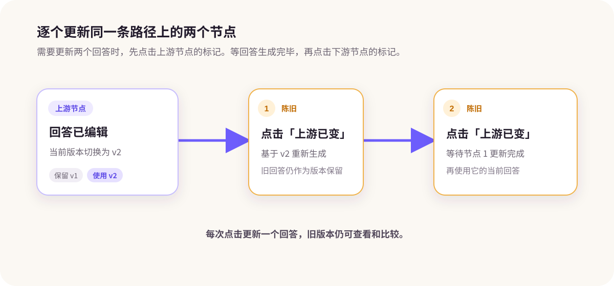

# 版本、陈旧与重放

## 比较回答版本

**原地重新生成**会在同一节点增加回答版本。你可以切换版本、删除不需要的版本，或恢复旧版本。若比较结果应该同时留在画布上，则使用[兄弟节点](/zh/guides/conversations#重新生成与比较)。

## 理解“陈旧”

生成节点会记录上游上下文指纹。编辑祖先节点、修改相关连线，或切换上游当前版本，都可能让依赖节点显示**陈旧**。

**陈旧**表示“基于旧输入生成”，不表示“答案一定错误”。先检查上下文差异，再决定是否更新。

## 更新单个陈旧节点 {#重放下游工作}

检查变更后的来源内容和节点的[输入连线](/zh/guides/context-control#检查下一次请求)。需要更新回答时，点击该节点上的**上游已变**。新回答会保存为该节点的一个新版本。

如果要更新同一条路径上的两个节点，先更新上游节点。等它生成完毕，再点击下游节点的**上游已变**，让下游使用新的上游回答。

